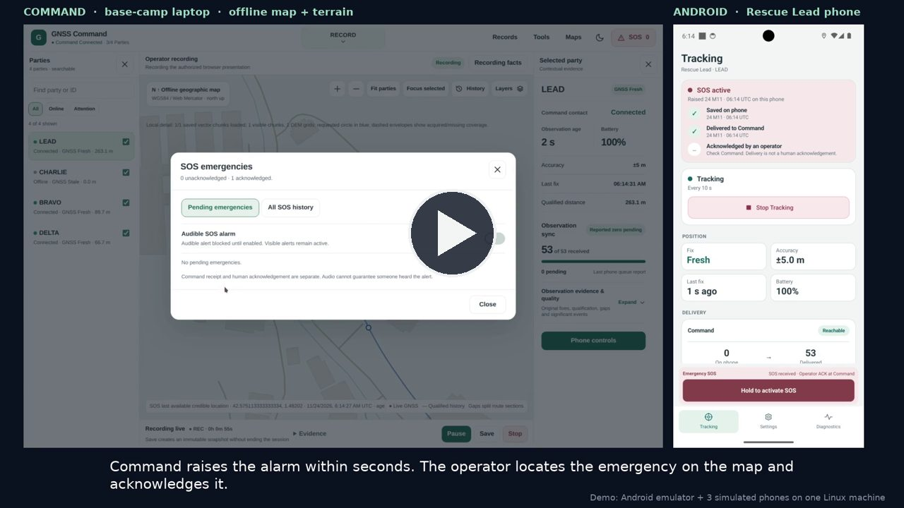

# GNSS Android Tracking

Offline-first team tracking for places with no internet and no cellular network.

Android phones measure GNSS positions, store them durably and send them over a local
Wi-Fi network to **GNSS Command**, a portable desktop application on one laptop. Command
stores every observation before acknowledging it, decides which fixes are credible,
builds tracks and travelled distance, raises SOS alerts and shows everything on a local
map with saved terrain. Field operation needs no internet, SIM, cloud service or online
map: the map and terrain for an area are downloaded once, before deployment.

**Current release:** v1.1.1 (pre-release), open source under GPL-3.0-only. See
[Releases](https://github.com/suraj-singh12/gnss-android-tracking/releases) and the
known limitations below.

## Demo

[](docs/media/demo.mp4)

A simulated mountain search-and-rescue near Arinsal, Andorra (3 min; Command and phone
side by side): offline map and terrain, phone setup, four teams on the map, a team
leaving Wi-Fi range, an SOS from the phone acknowledged by the operator, and replay of
the saved operation. It was recorded on Linux with an Android emulator, simulated GNSS
and three simulated phones; it is not physical field evidence.

## Why it matters

Most tracking tools assume a phone signal or an internet connection. Disasters, mountains,
forests, mines and remote sites often have neither. This project keeps a team visible
using only the phones, one laptop and a local Wi-Fi network:

- **Nothing is silently lost.** Each phone saves a fix before sending it, and a fix counts
  as delivered only after Command has stored it and acknowledged it.
- **Old data is never shown as live.** A team that leaves Wi-Fi range keeps its last known
  position, clearly marked as old; gaps are never counted as distance travelled.
- **SOS is separate from receipt.** An emergency stays open on Command until an operator
  acknowledges it.
- **Operations can be replayed.** Saved recordings are immutable and can be played back
  later.

## Use cases

| Use | How it helps |
| --- | --- |
| Disaster response | Coordinate rescue teams after earthquakes, floods or storms when mobile networks are down |
| Search and rescue | See every search team live, receive SOS with location and notice teams that lose contact |
| Remote field operations | Track crews in forestry, mining, utilities, pipelines or border areas without coverage |
| Scientific research | Record survey routes for geology, ecology, glaciology or archaeology and replay them later |
| Training and debriefs | Replay exercises and real operations to review decisions and timing |
| Events and expeditions | Follow marshals, trail runners or expedition teams across large outdoor areas |

## Components

| Directory | Responsibility |
| --- | --- |
| [android/](android/README.md) | Kotlin Android app: GNSS collection, Room durability, tracking service, reliable sender, SOS |
| [command/](command/README.md) | Portable Go Command app: durable receipt/ACK, SQLite history, quality, recording, maps, dashboard |
| [protocol/](protocol/protocol-v1.md) | Versioned Android ↔ Command wire contract and shared fixtures |
| [test-tools/](test-tools/README.md) | Phone simulator, mock receiver, contract tests and browser/bridge integration suites |
| [docs/](docs/architecture.md) | Architecture, design system, UI acceptance and approved designs |

The two applications communicate only through [Protocol v1](protocol/protocol-v1.md).
Android owns measurement, local durability and transmission. Command owns receipt,
interpretation, recording, horizontal travelled distance and presentation.

```text
Android: GNSS → foreground tracking service → Room (stored before send) → single Sender
         → local Wi-Fi → POST :8080/api/v1/messages
Command: validate → SQLite commit (before ACK, deduplicated) → quality policy → tracks,
         recordings, SOS → local dashboard http://127.0.0.1:8081
```

## Download

Each release publishes assets built by CI from one commit on its `release/vX.Y.Z` branch:

| Asset | Platform |
| --- | --- |
| `GNSS-Tracker-debug.apk` | Android 8.0 (API 26) or newer, debuggable build signed with the permanent field key (from 1.1.0) |
| `GNSS-Command-macos-arm64` | macOS on Apple silicon, unsigned |
| `GNSS-Command-windows-x64.exe` | Windows x64, unsigned |
| `GNSS-Command-linux-x64` | Linux x64 |
| `manifest.json`, `SHA256SUMS` | Source revision, build details and checksums |

Verify downloads with `sha256sum -c SHA256SUMS` (or `shasum -a 256 -c` on macOS).

## Quick start

1. **Command:** run the binary for your laptop (on macOS/Linux, `chmod +x` it first). Open
   `http://127.0.0.1:8081` in a browser on the laptop. Allow inbound TCP port 8080 in the
   laptop firewall on the trusted field LAN.
2. **Android:** install the APK, then in **Settings** set the party ID/name and the Command
   base URL, e.g. `http://192.168.1.10:8080` (the laptop's LAN address). Grant precise
   location and notifications, then tap **Start Tracking**.
3. Parties appear in Command's Parties panel as observations arrive.

Command flags and storage locations are in the [Command guide](command/README.md).
For a first real phone → Command run, follow [device acceptance](android/DEVICE-ACCEPTANCE.md).

## Build and test from source

Requirements: Go 1.24.7+, JDK 17, Android SDK platform 35 and build-tools 35.0.0.

```sh
cd android && ./gradlew testDebugUnitTest lintDebug assembleDebug --console=plain
cd command && go test -race ./... && go vet ./...
cd test-tools && go test -race ./... && go vet ./...
test-tools/integration/run.sh --console=plain   # real Android Room/Sender → Command bridge
```

Browser suites (Playwright) are described in [integration tests](test-tools/integration/README.md).
CI ([workflow](.github/workflows/ci.yml)) runs on pushes to `main`, `dev` and
`release/**` branches and on pull requests into `dev`, and uploads the release assets above.

## Documentation

- [Architecture](docs/architecture.md): authorities, data flow, recording, quality, SOS, maps
- [Protocol v1](protocol/protocol-v1.md): normative wire contract
- [Android guide](android/README.md) and [Android UI development](android/UI-DEVELOPMENT.md)
- [Command guide](command/README.md)
- [Design system](docs/design-system.md), [UI acceptance](docs/ui-acceptance.md),
  [UI preservation matrix](docs/ui-preservation-matrix.md)
- [Project handoff](docs/project-handoff.md): full state and planning context
- [Changelog](CHANGELOG.md), [security policy](SECURITY.md) and [third-party notices](THIRD_PARTY_NOTICES.md)
- [Agent and contributor rules](AGENTS.md)

The current interfaces follow the approved designs: Command V5.14 (mode picker, Parties,
map, Details, recording/playback rail, centred windows) and Android v3 (Tracking,
Settings, Diagnostics).

## Branches and contributions

- `dev`: development branch. Issue branches start from `dev` and PRs target `dev`.
- `main`: promoted from `dev` by a `dev` → `main` PR when the operator approves.
- `release/vX.Y.Z`: cut from `main` for each release; the `vX.Y.Z` tag is on this branch.
- `integration/combined-upgrades`: kept for history; no longer a PR target.

Work is issue-first, one `devX` branch per approved issue. See [AGENTS.md](AGENTS.md).

## Known limitations

v1.1.1 is a pre-release. CI verifies software behaviour on Linux and an Android emulator,
but these are not yet verified:

- Native macOS and Windows Command runtime, including the 20+1 phone Windows run ([#23](https://github.com/suraj-singh12/gnss-android-tracking/issues/23))
- Physical Android field acceptance: GNSS accuracy, Doze/OEM behaviour, multi-day offline
  sync, enrollment, alerts and SOS volume key ([#7](https://github.com/suraj-singh12/gnss-android-tracking/issues/7))
- Physical SOS speaker output on the Command laptop
- Live map-provider downloads (the `dem-provider` CI job reports provider refusals and limits as warnings)
- Command builds are unsigned; there is no installer. Android 1.0.0 used a temporary key, so it must be
  synced and uninstalled once before installing 1.1.0; later versions update in place

Physical-key SOS works only while the Android app is in the foreground; locked-screen
activation is unsupported.

## License

Copyright (C) 2026 suraj-singh12. Licensed under the
[GNU General Public License v3.0 only](LICENSE) (SPDX: `GPL-3.0-only`). You may use, study,
share and modify it; distributed modified versions must also be GPL-3.0-only with source.
Third-party components keep their own licences; see
[third-party notices](THIRD_PARTY_NOTICES.md). Releases v1.0.0 and v1.1.0 were published
under the earlier proprietary licence; v1.1.1 and later are GPL-3.0-only.
