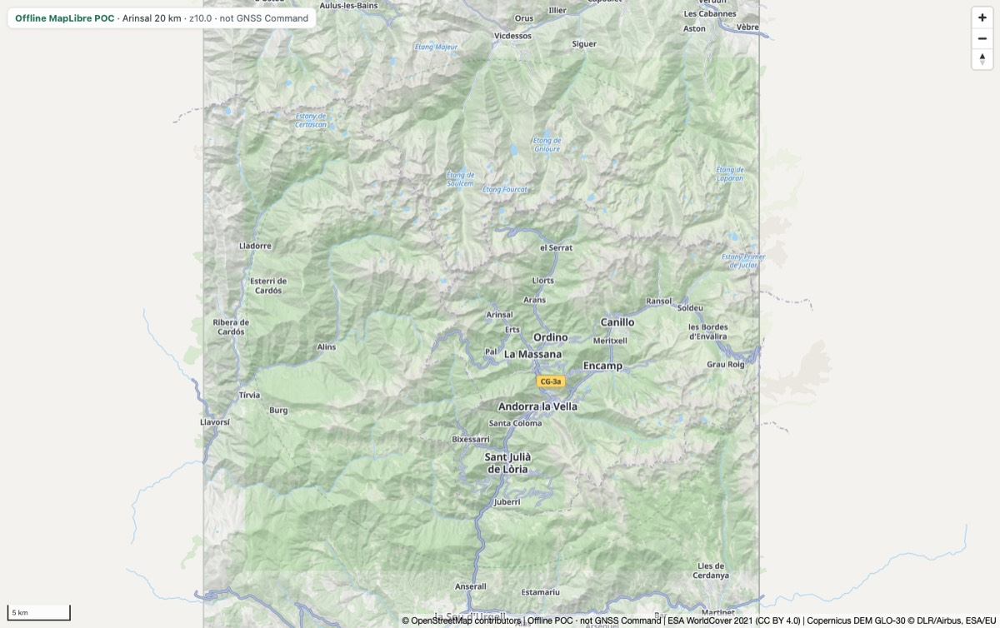
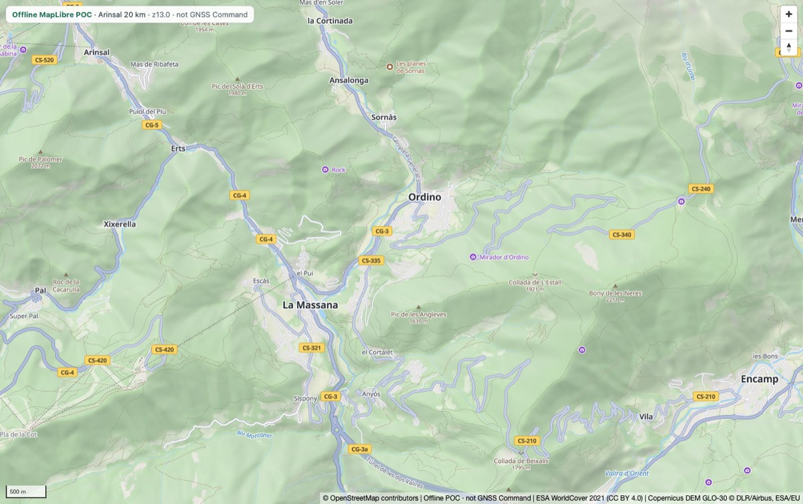
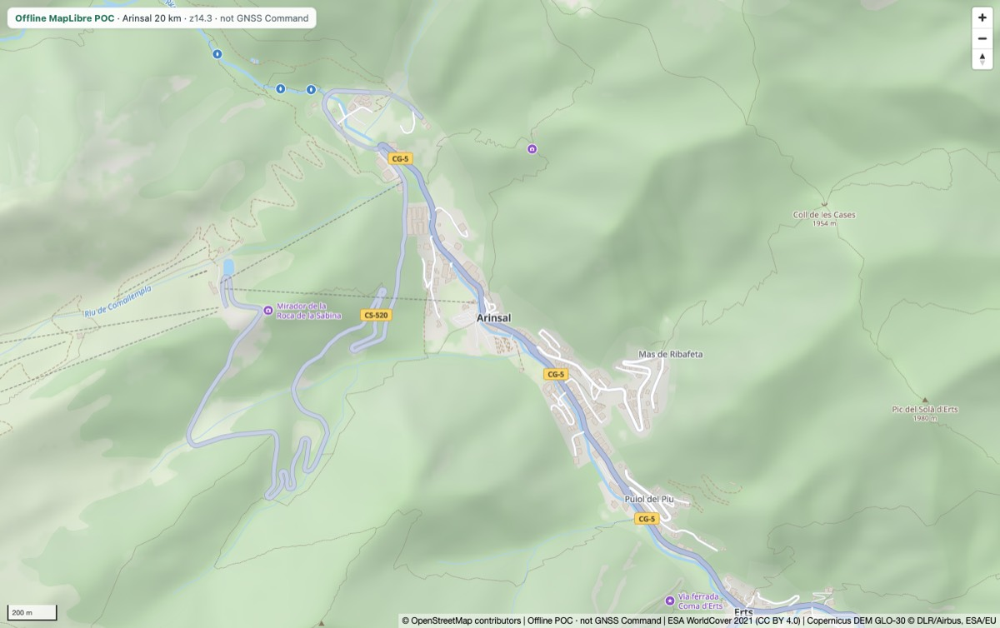
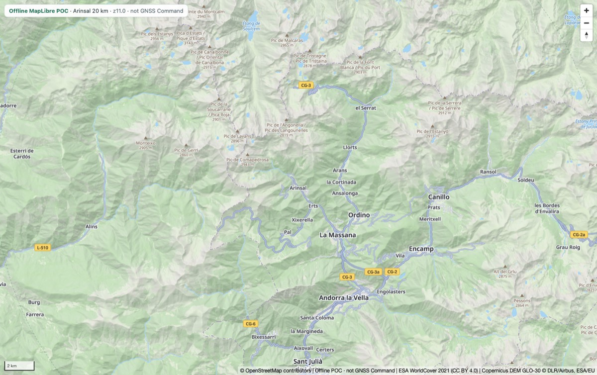
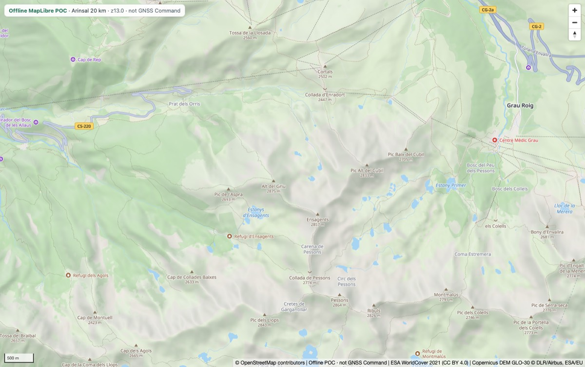
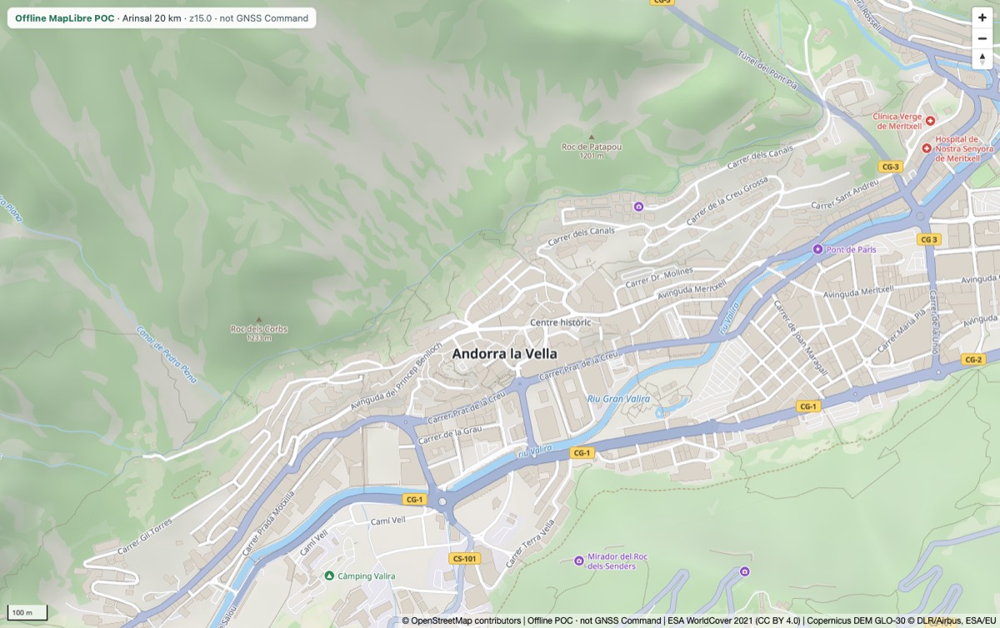
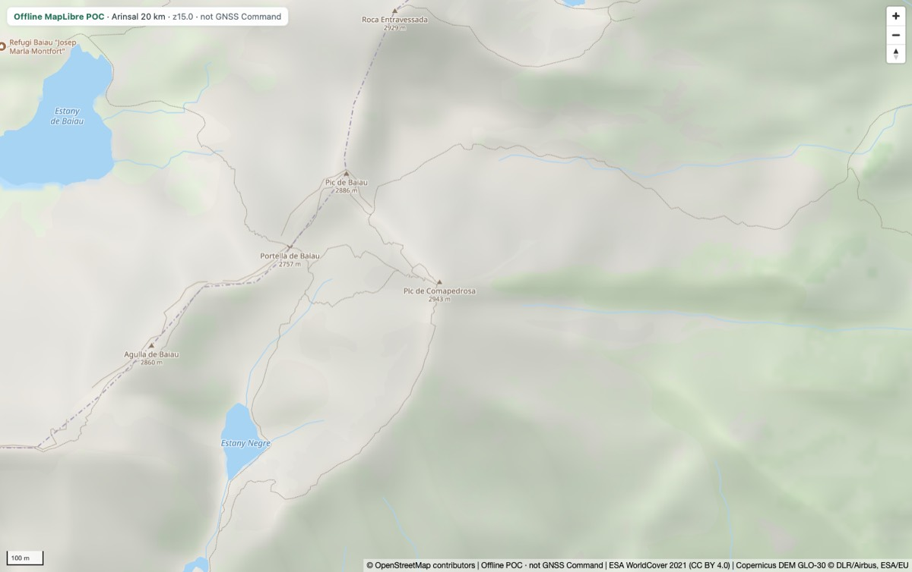
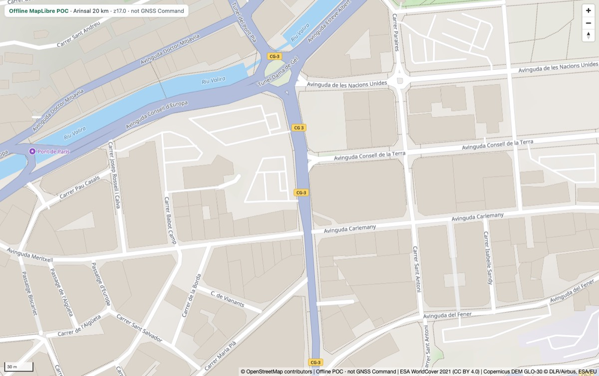

# Issue #88: MapLibre GL JS interactive offline map POC

Tracked in [#88](https://github.com/suraj-singh12/gnss-android-tracking/issues/88); continues
[RENDERING-EVALUATION.md](RENDERING-EVALUATION.md). POC only: no Command, Android or GNSS code
changed; no satellite, 3D, contours, night mode, acquisition UI or recording work.

## Download and try it on any machine

Portable offline build (34.8 MB, no installation, no internet needed after download):
[download/gnss-offline-map-poc-arinsal.zip](download/gnss-offline-map-poc-arinsal.zip)
([SHA-256](download/gnss-offline-map-poc-arinsal.zip.sha256)). Direct link:
https://github.com/suraj-singh12/gnss-android-tracking/raw/devX/issue-88-offline-map-builder-poc/poc/issue-88-offline-map-builder/download/gnss-offline-map-poc-arinsal.zip

Unzip, then run the viewer for your system: `open-map-windows.exe`, `open-map-macos-apple-silicon`,
`open-map-macos-intel` or `open-map-linux`. It serves the map on `http://127.0.0.1:8770` (this
computer only) and opens the browser. The viewers are unsigned: on macOS right-click > Open (or
`xattr -dr com.apple.quarantine` on the folder); on Windows SmartScreen choose More info > Run
anyway. Use Chrome, Edge or Firefox with hardware graphics. `README.txt` in the zip repeats this.
The viewer is `maplibre/server` (Go, standard library only, loopback only, files served from
memory); `maplibre/package.py` builds the zip.

## Try it on the POC laptop

The bundle (tiles + MapLibre + fonts, 27 MB) is already built on the POC laptop:

```sh
poc/issue-88-offline-map-builder/maplibre/launch.sh      # opens http://127.0.0.1:8770/
```

Scroll or pinch to zoom, drag to pan, double-click to zoom in, use +/−. The URL keeps the view.
Area: 20 km around Arinsal, Andorra (existing POC data; no new geographic download).

Rebuild from the existing POC run (about 45 s, no network):

```sh
~/gnss-poc-88-work/tools/gis/bin/python3 maplibre/build.py --run ~/gnss-poc-88-work/runs/cold \
  --cache ~/gnss-poc-88-work/cache-final --node ~/gnss-poc-88-work/node --out ~/gnss-poc-88-work/maplibre-bundle
```

Tools: osmium, tippecanoe 2.79 and GDAL (conda-forge env), MapLibre GL JS 6.19.0 and
`@fontsource/noto-sans` from npm (all outside the repository). Measurements and captures:
`maplibre/evaluate.cjs` and `maplibre/compare.cjs`.

## How it is built

| Part | Choice |
| --- | --- |
| Engine | MapLibre GL JS 6.19 (BSD-3-Clause), WebGL, served locally as ES modules |
| Vector data | Existing Arinsal OSM crop → 14 classified layers (roads with names/refs, paths, buildings, water, waterways, forest/grass/rock/ice, land use, places, summits, POIs, aerialways, railways, cliffs, borders) → tippecanoe vector tiles z6–14 (overzoomed to z18). Each feature carries a minimum zoom by class or size; tippecanoe reported **no dropped features** |
| Relief | Existing Copernicus DEM → Terrarium-encoded raster-DEM tiles (z≤12) → MapLibre's native hillshade |
| Vegetation | Existing ESA WorldCover window → soft colour raster under OSM forest/grass polygons |
| Text | Noto Sans (OFL) webfonts declared with the style's `font-faces`; no glyph server or download |
| Icons, shields | Drawn on a canvas at runtime (restrained circles with white glyphs; yellow route shields) |
| Style | Own palette and hierarchy (soft land, green vegetation, blue water, blue-grey main roads with casing, white local roads, dotted paths, yellow shields, settlement-first labels); no third-party style or assets |
| Server | `serve.py`, stdlib Python, loopback only, reads MBTiles directly |

## Screenshots (actual MapLibre rendering; MapLibre zoom numbers)

| Overview | Intermediate | Detail |
| --- | --- | --- |
|  z10 |  z13 valleys |  z14 Arinsal |
|  z11 |  z13 Pessons lakes |  z15 Andorra la Vella |
| |  z15 summits and trails |  z17 buildings |

Screen recording (30 s, real mouse wheel and drag input, Chrome):
[evidence/maplibre/zoom-pan-recording.webm](evidence/maplibre/zoom-pan-recording.webm)
(open in Chrome or Firefox; the recorder captures at 25 fps).

## Compared with the current Command renderer

Same Arinsal data, same centre and scale (raster zoom z = MapLibre zoom z − 1):
[overview](evidence/maplibre/compare/overview.jpg), [valleys](evidence/maplibre/compare/valley-terrain.jpg),
[Arinsal](evidence/maplibre/compare/arinsal-detail.jpg), [summits and lakes](evidence/maplibre/compare/coma-pedrosa-detail.jpg),
[Pessons lakes](evidence/maplibre/compare/pessons-lakes.jpg), [town](evidence/maplibre/compare/andorra-la-vella-detail.jpg).

| | Current Command | Canvas POC (previous) | MapLibre POC |
| --- | --- | --- | --- |
| Overview (whole 20 km) | 32,650 features skipped, terrain in 8 of 56 chunks, 4.9 s to assemble | everything drawn, raster-zoom only | everything drawn, settlement-first, 0.7 s |
| Zoom | stepped, re-parses chunks each change | stepped integer zooms | continuous, smooth, 60 fps |
| Labels | none for geography | simple greedy | native collision, line labels, shields, priorities, fades |
| Road hierarchy | one width, one colour | basic | 7 classes with casing and zoom-scaled widths |
| Hillshade | browser-computed, 8 grids | pre-rendered tiles | native from DEM tiles, everywhere |
| Engineering | existing | about 300 lines custom | about 135 lines of style + 100 runtime + 250 tile build, standard engine |

## Measurements (Apple M3, 8 GB, macOS, Google Chrome)

| Measure | Result |
| --- | --- |
| Tile build from existing data | 43 s, no network |
| Storage | vector tiles 7.5 MB + DEM tiles 16.2 MB + land cover 1.4 MB + runtime 2.1 MB (MapLibre 1.7 MB) = 27 MB; Command's current package for the same area is 43 MB expanded |
| Cold start (server restarted, new browser) to fully drawn map | 0.74 s headless, 1.1 s visible window |
| Jump to any area/zoom to fully drawn | 0.66–0.71 s (includes label fade-in) |
| flyTo z10 → z16 (4.9 s) | 294 frames, median 16.7 ms, p95 17.5 ms, worst 21.1 ms, 0 frames over 33 ms (60 fps) |
| Continuous panning at z15 | median 16.7 ms, p95 17.6 ms, worst 23.8 ms, 0 over 33 ms |
| Zoom out z16 → z10 | median 16.7 ms, p95 17.4 ms, 0 over 33 ms |
| GPU path | ANGLE Metal, Apple M3 |
| Offline | Server restarted inside a macOS sandbox denying all non-loopback connections; Chrome aborted and recorded every non-loopback request: **0 external requests** across load, 8 views, 3 animations and the recording |

Frame times are from a visible Chrome window on a 60 Hz Retina display; headless Chrome
throttles animation frames and is used only for screenshots. Not measured: Windows, Intel or
older GPUs, low-end laptops, Safari/Firefox.

## Known limitations of this POC

- Relief and vegetation soften above MapLibre z14, because the DEM is about 28 m and
  WorldCover 10 m. Building a z13 DEM tileset would help slightly; better data would help more.
- OSM multipolygon relations are included (osmium assembles them here), but no Command import
  path does this yet.
- One style, Day only; POI selection, colours and minimum zooms are first-pass and need review.
- Labels are in the local languages recorded in OSM (Catalan, Spanish, French); no translation.

## Integration risks

1. **Hardware and portability.** MapLibre needs WebGL (WebGL2 preferred). Most laptops since
   about 2012 have it, but the risky cases for field laptops are old Intel GPUs, remote-desktop
   sessions, virtual machines and blocklisted drivers, where Chrome falls back to software
   rendering (SwiftShader), which is much slower. Command needs a fallback: keep the current
   SVG/canvas map as a no-WebGL mode, and test on the actual Windows field laptops (#23) early.
2. **Recording fidelity (#27/#37).** Recordings currently freeze the background as SVG
   geometry. A WebGL map cannot be serialised the same way. New recordings would have to record
   the pinned tile/style/font hashes plus the camera (centre, zoom, size) and re-render on
   playback. That is deterministic for geometry, but label placement can differ between
   MapLibre versions, so the MapLibre version and style must be pinned in the evidence too. This
   is the largest design item and needs agreement before integration.
3. **GNSS overlays.** Tracks, markers and SOS can stay in Command's SVG layer on top, driven by
   `map.project()` on every camera change, or move into MapLibre GeoJSON layers. Keeping SVG
   preserves today's evidence, accessibility and interaction code; it needs care to stay in sync
   during animated zooms.
4. **Data pipeline.** Command does not have tippecanoe. Production needs a Go equivalent: vector
   tile generation (MVT encoding, per-zoom simplification, clipping), or tiles prepared by a
   separate tool and imported as a package. Go MVT libraries exist (licences to be checked for
   GPL-3.0 compatibility); this is real work, not a configuration change.
5. **Distribution.** MapLibre GL JS (1.7 MB, BSD-3-Clause) and Noto Sans (OFL) can be embedded
   in Command's binary like the existing web assets; both are GPL-compatible and would go in
   `THIRD_PARTY_NOTICES.md`. The CSP must allow the worker and `blob:` URLs MapLibre uses.
6. **Storage.** Vector tiles are smaller than today's GeoJSON chunks; the DEM tileset is the
   largest part (WebP or a z11 cap would shrink it).

## Recommendation

**MapLibre is appropriate for Command's map background, conditionally.** In about one
engineering day it produced the cartography, continuous zoom, label collision and offline
behaviour that a custom renderer would take months to approach. The visual and interaction gap
to consumer maps is closed for the data we have. Proceed only if:

1. the target Windows field laptops render it acceptably with hardware WebGL, and a non-WebGL
   fallback (the current renderer) is kept;
2. a recording-evidence design based on pinned tiles, style and camera is agreed for #27/#37;
3. vector tiles are produced by a GPL-compatible Go pipeline (or an approved preparation tool),
   since tippecanoe cannot ship inside Command.

If any of these fail, the Phase 1 canvas renderer in
[RENDERING-EVALUATION.md](RENDERING-EVALUATION.md) remains the fallback plan. Recommended next
step: a short hardware check on real field laptops, then an integration design issue covering
tiles in Go, the overlay strategy and recording evidence. No issue is created yet.
