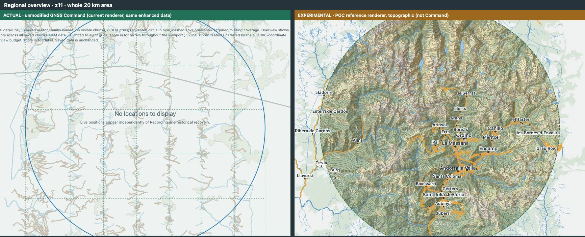
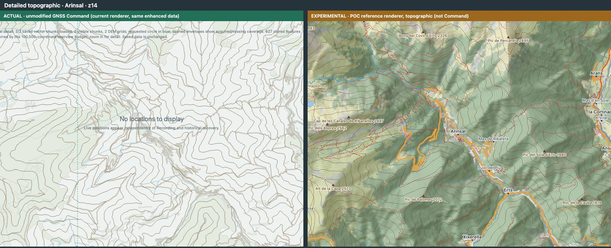
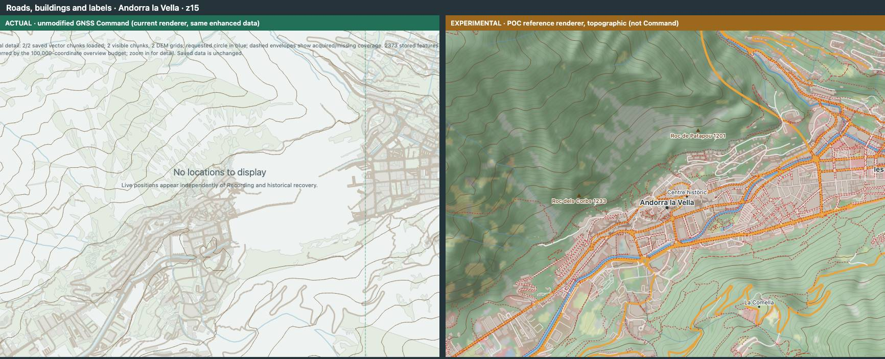
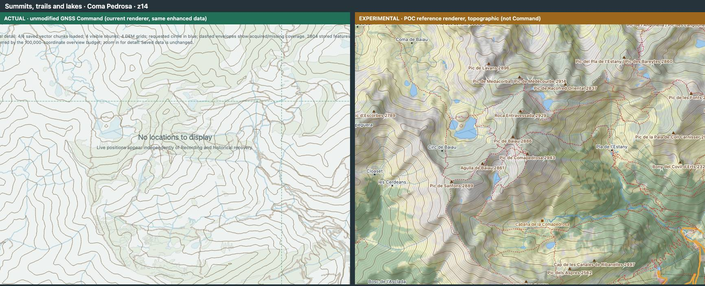
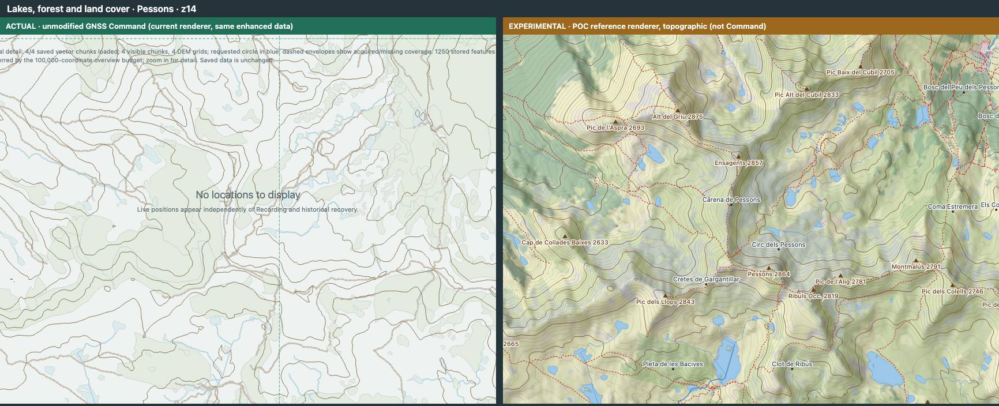
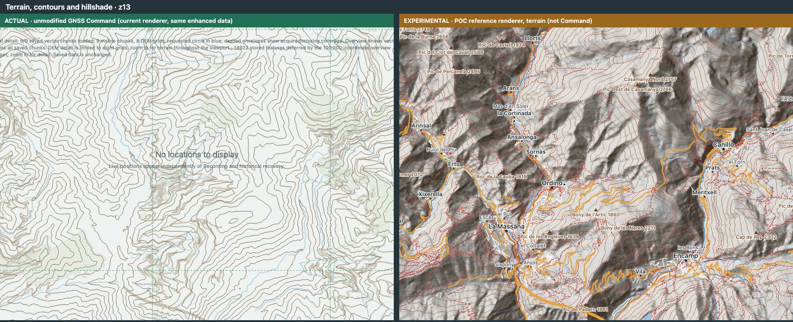
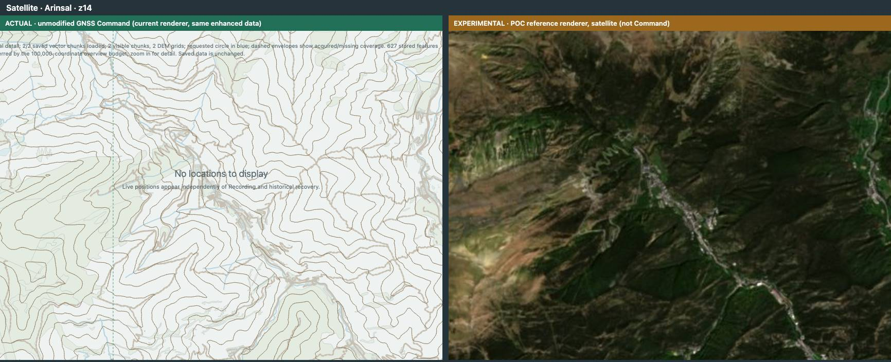
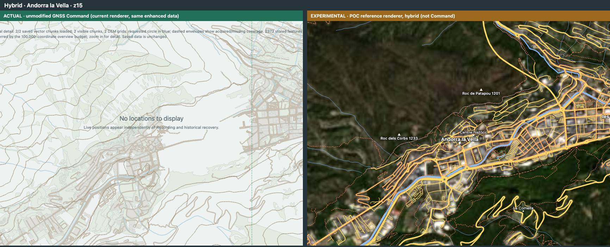
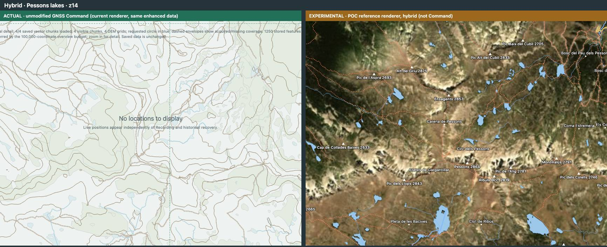

# Issue #88 follow-up: post-POC evaluation and map rendering upgrade design

Design and evaluation only. No production code, dependency, UI or issue was changed or
created. Inputs: the existing Arinsal POC run (`runs/cold`, 24 Nov 2026) and Command at
`dev` `b882d42`. No new downloads were made. New local measurements are marked
*measured*; estimates are marked as such.

## 1. What we stand to gain: side-by-side

Left: **actual unmodified Command**, showing the enhanced Arinsal package (Copernicus terrain,
the same OSM ways), hillshade and contours switched on, default 50% map opacity, captured in a
network-denying sandbox after Command reported the viewport complete. Right: the **POC
reference renderer** (experimental canvas viewer, not Command) drawing the same prepared data.
Same WGS84 centre, same Web Mercator scale, same crop size. The Command baseline (Skadi terrain)
looks the same as the left column and is in [evidence/captures](evidence/captures/).

| | |
| --- | --- |
| Regional overview, z11 |  |
| Detailed topographic, Arinsal z14 |  |
| Roads, buildings, labels, Andorra la Vella z15 |  |
| Summits, trails, lakes, Coma Pedrosa z14 |  |
| Lakes, forest, land cover, Pessons z14 |  |
| Terrain, contours, hillshade, z13 |  |
| Satellite, Arinsal z14 |  |
| Hybrid, Andorra la Vella z15 |  |
| Hybrid, Pessons z14 |  |

The difference is overwhelmingly the renderer, not the data: both columns draw the same
prepared Arinsal data. The right column is the target appearance, not a mock-up.

## 2. Rendering bottlenecks (source inspection + measurement)

*Measured* in headless Chromium (Apple M3), time until Command reported the viewport complete:

| View | Command assembly time | Stored features not drawn |
| --- | --- | --- |
| Overview z11 (56 chunks) | 4.9 s | 32,650 |
| z13 valley | 3.3–3.7 s | 14,922 |
| z14 (4 chunks) | 0.5–1.5 s | 627–2,804 |
| z15 Andorra la Vella | 1.3 s | 2,373 |

Causes, in order of impact:

1. **One fixed coordinate budget, split evenly, filled in file order.** `app.js:3221` gives each
   visible chunk `100,000 / visibleChunks` coordinates (about 1,785 at overview), and
   `GeoMap.overview` (`map.js:149`) keeps features **in stored order until the share is
   used**, then omits the rest. Nothing ranks a main road above a garden shed, and dense
   chunks lose most of their content. This is the vertical-strip pattern in the overview capture.
2. **Detail is reduced at draw time, not at preparation time.** Lines are thinned by a
   one-pixel radial filter; polygons are kept exact, so sub-pixel buildings and land-use
   polygons consume the budget at every zoom. There is no zoom-dependent class filter
   (buildings are requested at z11).
3. **SVG DOM rendering.** Every shape becomes an SVG element and the whole offline layer is
   rebuilt on each `draw()` (`app.js:2158`). That DOM cost is why the budget exists at all.
   Each viewport change also re-fetches and re-parses every visible chunk's GeoJSON (up to
   20 MiB each), which explains the 4.9 s overview.
4. **Terrain capped at 8 grids** (`app.js:3268`): terrain is computed in the browser from
   257² grids (marching squares + Horn shading) and only 8 are processed, so overview shows
   hillshade in a strip. Contour intervals are chosen per view, not cartographically.
5. **Data never reaches the renderer.** The PBF importer iterates ways only
   (`map_pbf.go:386-399`) and keeps five tag keys, so place names, summits, huts (3,085 nodes)
   and multipolygon lakes and forests (1,597 relations) are dropped at import.
6. **Minimal cartography.** Four colours, every road the same 3 px line, no labels for
   geographic features, map at 50% opacity by default (`index.html`, `map-opacity`), and no
   raster layer type for imagery or land cover.

*Measured* zoom-band generalisation of the same Arinsal layers (class filter + simplification,
done locally with OGR on the existing data):

| Zoom band | Content | Features | Coordinates | Size (int32 pairs) |
| --- | --- | --- | --- | --- |
| ≤ z11 | major roads, rivers, lakes and forest ≥ 20 ha, 40 m tolerance | 3,843 | 58,552 | 0.5 MB |
| z12–13 | all but buildings/small polygons, 10 m tolerance | 29,350 | 323,555 | 2.6 MB |
| ≥ z14 | full geometry, whole area | 61,607 | 1,752,496 | 14.0 MB |

The **whole 20 km overview fits in 59k coordinates**, below today's budget, with nothing
deferred. A z14 viewport sees a small fraction of the full band. The overview problem is
solved by preparing generalised bands once at import, not by a faster drawing engine.

### Can the current renderer be extended?

Yes. The projection (`GeoMap`), chunk plan and storage, viewport/interaction code, GNSS/SOS
overlays and terrain mathematics are sound and should stay. What has to change is how the
**offline background** is prepared and drawn:

| Option | Quality | Responsiveness | Maintainability / portability | Verdict |
| --- | --- | --- | --- | --- |
| A. Keep SVG, add ranking, bands and labels | Better at detail | DOM cost still limits z12–13 and dense towns | No new tech | Partial: helps, but leaves the mid-zoom ceiling |
| **B. Canvas 2D background under the existing SVG overlays, fed by prepared zoom bands** | Matches the right-hand column | POC viewer pans in 19.6–22.7 ms median with the full dataset (*measured*) | No dependency; vanilla JS like the rest of Command; works offline in any browser | **Recommended** |
| C. MapLibre GL + vector tiles | Excellent | Excellent | New ~1 MB dependency, WebGL requirement, new tile format/styles, replaces interaction and the evidence model | Rejected: rewrite-sized for this need |
| D. Server-side Go raster tile rendering | Good at fixed zooms | Fast client | Needs a 2D/font library in Go, bakes labels in, larger storage | Rejected for vectors; used only for terrain and imagery rasters |

## 3. Recommended rendering upgrade

**Retain:** GeoMap projection and viewport model; the chunk plan, keys and SQLite store;
PBF import and crop indexing; GTERR001 and `Terrain` algorithms; GNSS tracks, markers, SOS,
labels and controls as SVG **on top**; Layers popup; `.gmap.zip` validation and pinning.

**Modify or add (one coherent upgrade):**

1. **Import keeps what maps need.** Nodes with names (places, summits with `ele`, huts,
   shelters), multipolygon relation assembly for water, forest and land cover, and railway,
   aerialway and tourism tags, all inside the existing bounded crop pipeline.
2. **Prepared zoom bands per chunk.** At import Command derives overview and mid bands in Go
   (class filter + Douglas-Peucker), stored as additional chunk assets next to the full
   vectors. The client chooses the band by zoom, so no viewport ever drops arbitrary features.
3. **Canvas background renderer.** A small `map-canvas.js`, presentation-only like
   `workspace.js`. It parses each chunk band once and caches it in memory, culls by feature
   bounding box, and draws a class-based style table (road hierarchy, trail difficulty,
   water, forest, built-up, cliffs), with full map opacity by default.
4. **Labels.** Collision-aware labels for places, summits with heights, lakes and road refs,
   prioritised by class; drawn under GNSS and SOS overlays and kept clear of party markers.
5. **Terrain everywhere.** Precomputed hillshade raster tiles generated from GTERR001 in Go at
   import, replacing the 8-grid browser limit; contours at cartographic intervals (100 m with
   20 m index at overview, 20 m at detail) from the existing marching-squares code.
6. **Raster overlay layer.** Additive package asset type for 256 px tiles (`tiles/<layer>/z/x/y`)
   with provenance, date and native resolution, served by a loopback endpoint and drawn under
   vectors. Used for hillshade, land cover and Sentinel-2. Layers popup gains Satellite and Land
   cover switches with their date and resolution.
7. **Evidence compatibility.** Recording evidence (#27/#37) today freezes the background as
   SVG geometry. With a canvas background, new evidence records the pinned asset hashes,
   style version and viewport; playback re-renders from pinned assets. Recordings saved
   before the upgrade keep their frozen SVG and play back unchanged.

**Performance:** the overview draws about 59k coordinates (all data, nothing deferred);
mid zoom draws a viewport subset of 324k; detail draws a viewport subset of the full band.
Parse once per chunk band, redraw from memory on pan (about 20 ms per frame *measured* in the
POC viewer on an M3; low-end Windows laptops are **not measured** and need a budget check).

**Resources (estimates from the Arinsal data):** storage per 20 km map grows from 43 MB to
about 60–65 MB (full vectors 38 MB, bands about 5–9 MB as JSON, points under 1 MB, hillshade
tiles about 7 MB, land cover 3.5 MB, imagery 2.2 MB), which is 22–25% of the 256 MiB quota.
Browser memory: a few tens of MB of parsed geometry. Import CPU: a few seconds of Go per map
for bands and hillshade tiles. Distribution: no new dependency; the JS and Go additions are small.

**Compatibility:** existing saved maps without bands fall back to today's SVG path (or bands
are generated on first open where the source is still in the database); `.gmap.zip` format 1
imports unchanged and format additions are additive; GNSS, SOS, recording, Travel Back and
distance are untouched because the background stays presentation-only.

## 4. Outstanding POC questions

**Does 16% include every layer?** No. 16.0% = 43.0 MB expanded / 256 MiB (268.4 MB) and counts
only Command-supported assets: full vectors 38.2 MB + Copernicus terrain 4.7 MB. It excludes
imagery (2.2 MB), land cover (3.5 MB), the dropped nodes and relations, zoom bands and
hillshade tiles. With all of them the estimate is 60–65 MB, 22–25%.

**770 MB vs 794 MB.** All figures are decimal megabytes (10⁶ bytes) measured as tunnelled TLS
bytes by the proxy. The cold run downloaded 793.6 MB, of which 32.0 MB was Skadi terrain used
only for the comparison and the Command baseline. The enhanced map needed **761.6 MB
(726 MiB)**; 770 MB was that figure rounded up by hand for the prototype. A production
allowance should be computed before download from announced file sizes plus a bounded estimate
for windowed reads, and shown as "about 760 MB".

**Can the regional OSM download be avoided?** Mostly, yes (*measured* locally):

| Option | Transfer for Arinsal | Trade-off |
| --- | --- | --- |
| Regional Geofabrik extracts (POC) | 643 MB, once per region | Reliable; huge first download; reused afterwards (0 bytes warm) |
| **Overpass, filtered tags, gzip, per chunk** | about 25 MB (8.7 MB PBF-equivalent; 24.6 MB gzip XML) | Command already queries Overpass per chunk for ways; extend to nodes and relations. Public instance has rate limits and outages (502s seen in CI), so keep the regional extract as fallback |
| Prepared `.gmap.zip` shared by the organisation | 12–65 MB, or 0 in the field | Best for repeated deployments; needs someone to prepare it |
| Third-party vector tile builds / custom extract services | small | New data model or third-party terms; not recommended now |

With Overpass first, the High-detail Arinsal map would need about 135 MB instead of 762 MB
(estimate: 25 OSM + 43 DEM + 62 imagery + 2 land cover + 4 catalogue and geoid).

**Was 8–13 weeks justified?** It was a reasonable order of magnitude but under-scoped two
items: multipolygon relation assembly and recording-evidence compatibility. It also mixed
essential work with acquisition and UI. The revised breakdown is below.

## 5. Effort by deliverable (one engineer, estimates)

| # | Deliverable | Class | Estimate |
| --- | --- | --- | --- |
| R1 | Canvas background renderer, style table, band selection, parse cache, culling | Essential | 6–8 days |
| R2 | Go zoom-band generation at import + chunk assets + endpoint | Essential | 5–7 days |
| R3a | Import named nodes (places, summits, huts) and wider tags | Essential | 3–4 days |
| R4 | Collision-aware labels under GNSS/SOS overlays | Essential | 4–6 days |
| R5 | Hillshade tiles from GTERR001; cartographic contours; remove 8-grid cap | Essential | 4–6 days |
| R7 | Recording evidence and playback compatibility for canvas background | Essential | 5–8 days |
| T1 | Browser suite updates, performance budget, offline restart, 20+1 fleet regression with maps | Essential | 5–7 days |
| | **Phase 1 subtotal** | | **32–46 days (6.5–9 weeks)** |
| R3b | Multipolygon relation assembly across chunk crops (lakes, forests) | Strongly recommended | 5–7 days |
| R6 | Raster overlay asset type, validation, endpoint, Layers switches, quota | Optional (needed for satellite/land cover) | 6–8 days |
| A1 | Go COG windowed reader + WorldCover + Sentinel-2 STAC acquisition with cloud check | Optional (with R6) | 10–14 days |
| A2 | Overpass-first OSM nodes/relations with regional fallback | Optional (transfer) | 4–6 days |
| A3 | Copernicus DEM provider + EGM2008→EGM96 | Optional (small quality gain) | 4–5 days |
| U1 | Get a Map simplification after design approval | Optional (after R6/A1) | 5–8 days |
| H1 | Native macOS/Windows and low-end laptop performance acceptance | Hardening | 4–6 days |

Everything together is about 13–17 weeks. The essential rendering upgrade (Phase 1) is
6.5–9 weeks and delivers most of the visible gain: full overview, labels, summits, terrain
everywhere and readable cartography, with no new data sources and no new downloads.

## 6. Get a Map prototype review (presented, not redesigned)

The simulated v2 prototype is [design/get-a-map-prototype.html](design/get-a-map-prototype.html):
[area](evidence/captures/design-wide-area.jpg), [review](evidence/captures/design-wide-review.jpg),
[preparing](evidence/captures/design-wide-progress.jpg), [ready](evidence/captures/design-wide-ready.jpg),
[partial](evidence/captures/design-wide-partial.jpg), [failed](evidence/captures/design-wide-failed.jpg),
[no internet](evidence/captures/design-wide-offline.jpg), [390 px review](evidence/captures/design-narrow-review.jpg).

Critique against "simple, predictable, few clicks":

- **One step too many.** The flow is Search → Review → Prepare Map → Use This Map. The review
  can live on the same screen as a compact summary under the Detail choice, with the download
  line next to **Prepare Map** (the single consent). A separate review should appear only when
  something needs attention: missing coverage, a download far above usual, or low space.
  That gives Search → Prepare Map → Use This Map.
- **Too much metadata in the primary path.** Feature counts, source names, region names and
  image dates belong in a "Sources and details" disclosure; the primary rows should say only
  what the operator gets (Roads & trails, Names & summits, Terrain, Forest & land cover,
  Satellite) and whether each is available.
- **The download figure must be computed**, not hand-written ("about 760 MB; later maps in this
  region need much less").
- **Progress should be per layer only**; region and file names go into details.
- **Do not offer layers Command cannot show.** Satellite and land cover rows should appear only
  after R6 and A1 ship; until then High detail adds nothing visible.
- **Keep:** the existing window, tabs, location field, preview, radius chips, one consent,
  honest partial/failed states with Retry Missing, and "Use This Map" as an explicit action so
  a ready map never replaces the map in use during an operation.

## 7. Dependencies, risks and trade-offs

- Canvas background changes how recording evidence captures the map (R7); this is the main
  correctness risk and must be designed with #27/#37 owners before coding.
- Low-end Windows laptops are unmeasured; Phase 1 needs a frame-time budget and a fallback.
- Relation assembly across chunk boundaries is the hardest import task; without it many
  forests and some lakes stay missing (hence "strongly recommended").
- Overpass-first acquisition depends on a public service without SLA; the regional fallback
  and prepared packages remain necessary.
- Storage rises from 16% to about 22–25% of the quota per 20 km High map; still several maps fit.
- Imagery is 10 m: forests and fields, not buildings. Expectations must be set in the UI.
- No new third-party code is required for Phase 1 or R6; A1 needs a GPL-compatible Go TIFF/COG
  reader or a small in-house one.

## 8. Recommended issue sequence (not created)

1. **Map rendering upgrade, Phase 1** (R1, R2, R3a, R4, R5, R7, T1): canvas background, zoom
   bands, names and summits, labels, terrain everywhere, evidence compatibility. No new data
   sources. Needs a design approval for map cartography (style table) under the #62 gate.
2. **Multipolygon water and forest** (R3b), independently testable on existing maps.
3. **Raster overlay layers** (R6) using existing prepared tiles; makes hillshade tiles and future
   imagery/land cover first-class.
4. **Satellite and land-cover acquisition** (A1), then **Overpass-first OSM** (A2) to cut the
   first download from about 760 MB to about 135 MB.
5. **Get a Map simplification** (U1) after its own design approval.
6. Optional: **Copernicus DEM** (A3); **native and low-end performance acceptance** (H1) before
   release.

Issue 1 alone delivers the regional overview, labels, summits and terrain seen on the right
in captures 01–06, minus imagery and land cover. Issues 3–4 add the satellite, hybrid and
land-cover views (captures 05, 07–09).
