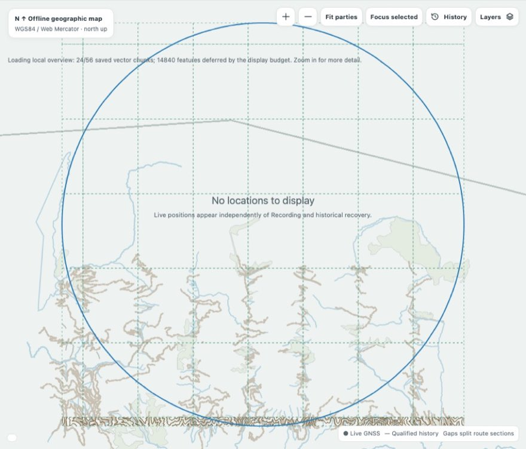
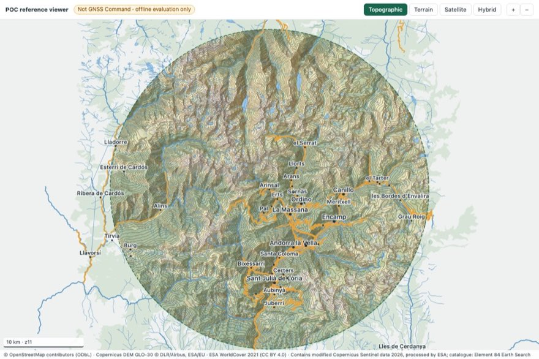
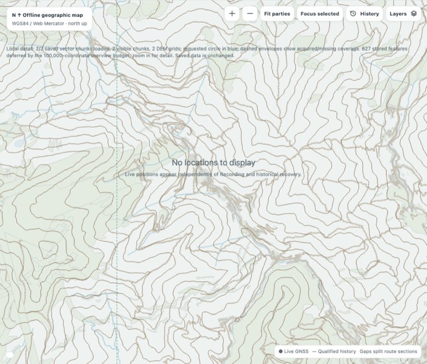
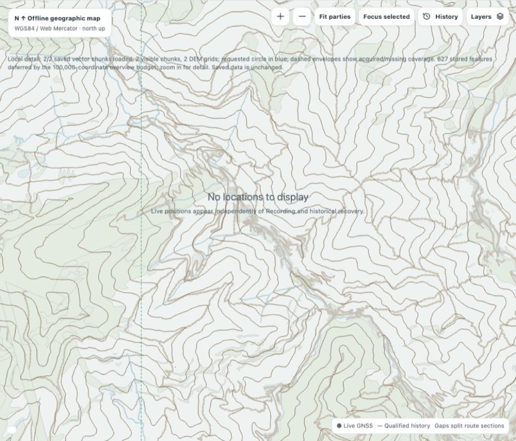
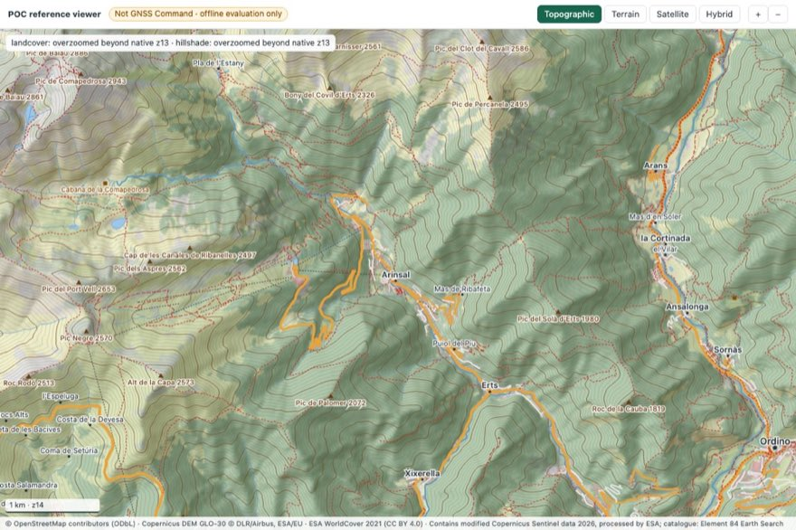
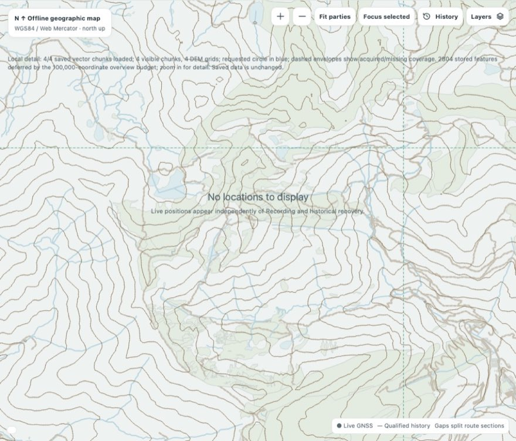
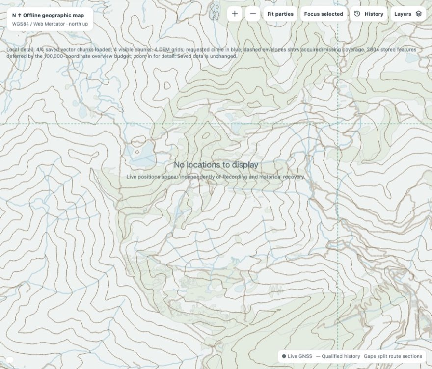
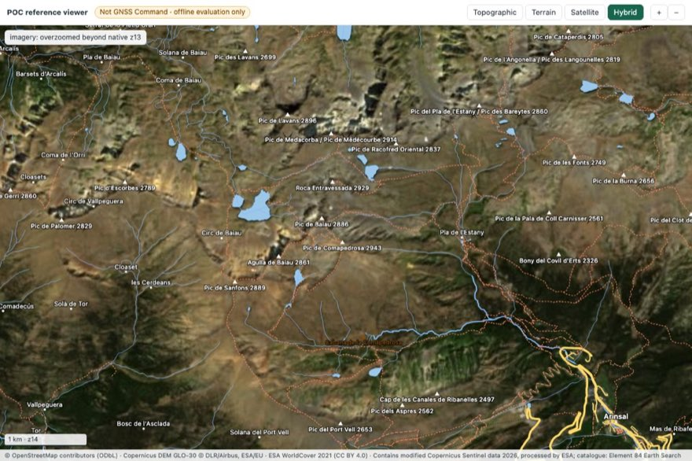
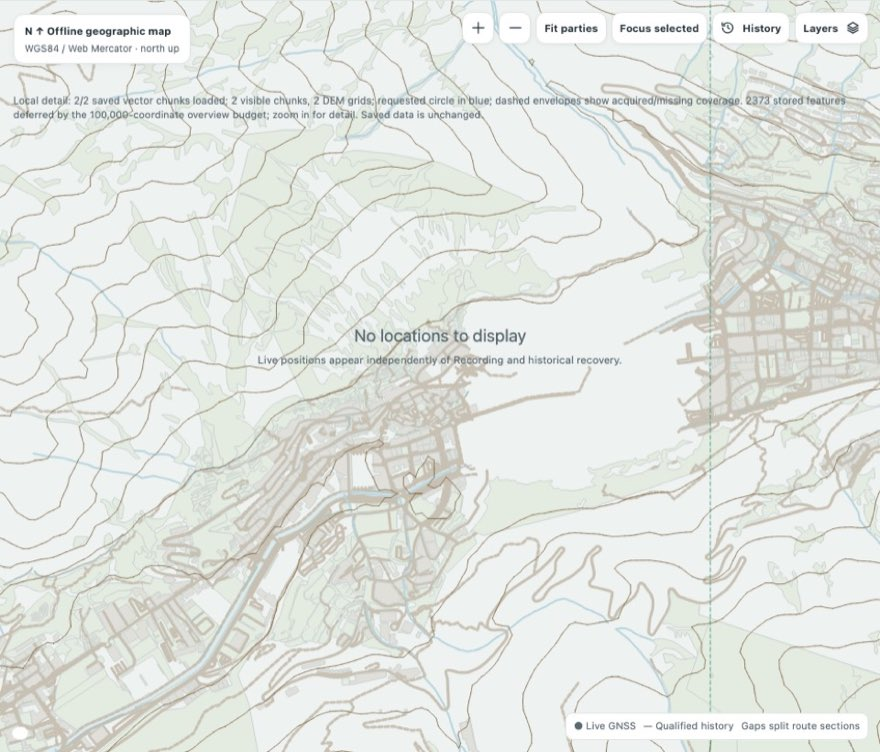
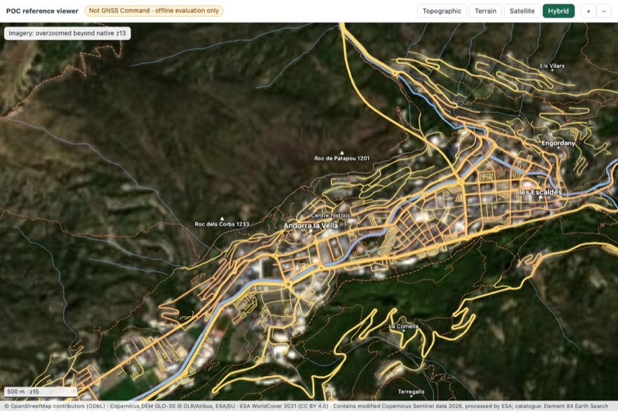

# Issue #88 POC decision report: high-detail offline maps and Get a Map

Tracked in [#88](https://github.com/suraj-singh12/gnss-android-tracking/issues/88).
Branch `devX/issue-88-offline-map-builder-poc`, parent `dev` at
`b882d42537267aef70d56ee43ec1728a5c920124` (verified latest remote `dev`, 24 Nov 2026).
The exact POC head SHA is recorded in the draft PR. Setup and reproduction are in
[README.md](README.md); raw measurements are in [evidence/metrics.json](evidence/metrics.json)
and [evidence/evaluation.json](evidence/evaluation.json).

**Status: feasibility evidence only. No production Command, Android, schema, renderer, UI,
packaging or CI change. The Get a Map design is a simulated proposal awaiting operator review,
not approved UI.**

## 1. Recommendation: revise, then proceed in three separate issues

| Question | Answer from measured evidence |
| --- | --- |
| Can an automated pipeline prepare much richer offline data for a real 20 km area? | **Yes.** One command produced all requested layer groups for Arinsal (1,257 km², three countries) with full coverage, no manual GIS, in 22.7 min cold (download-bound) and 62–63 s warm or fully offline. |
| Does that make maps materially better **in unmodified Command**? | **No, barely.** Command renders only tagged OSM ways plus 1″ terrain. Copernicus terrain fits the existing package unchanged, but its contours look almost identical to today's Skadi terrain. Imagery, land cover, place names, summits and OSM multipolygons do not render. |
| Is the data itself better? | **Yes, measurably.** Copernicus summits read a median 8 m below surveyed OSM heights versus 20 m for Skadi (453 peaks). WorldCover agrees with 94.9% of OSM lakes. Sentinel-2 imagery covers 100% of the circle with 0% cloud. 3,085 named places, summits and huts plus 1,597 multipolygons are available but dropped by Command today. |
| Does it fit the 256 MiB map quota? | **Yes.** Command package 12.2 MB zipped / 43.0 MB expanded (16% of quota); adding the imagery and land-cover tiles adds about 5.7 MB. |
| Is QGIS needed? | **No.** GDAL + osmium did every step. Nothing here needs QGIS on any laptop. |
| Is the operator journey simpler? | **Proposed, not tested.** The proposal keeps the current window and components, replaces the terrain toggle with a Detail choice and adds one honest review with one consent. Interaction count is similar to today; the gain is no mid-flow consent prompts and an honest pre-download review. Not timed with operators. |

Recommendation: **Revise.** The preparation side is proven; the value is blocked by
Command's renderer and package format. If the operator wants to proceed, split it into
three independently deliverable issues (section 11): (A) renderer and package support for
labels, multipolygons and raster overlays, plus the overview-budget limits; (B) Go-native
acquisition of Copernicus DEM, WorldCover and Sentinel-2 inside Command's existing job,
ledger and consent model; (C) the Get a Map redesign after explicit design approval.
Doing (B) without (A) adds downloads the operator cannot see.

## 2. Test area and sources

Centre 42.5722, 1.4847 (Arinsal, Andorra, the README demo area), 20 km geodesic radius,
1,257 km². Public, mountainous (751–3,120 m), with towns, roads, ski lifts, trails, lakes
and forest, crossing Andorra, Catalonia (Spain) and Ariège (France). Not an operational
location. Input: [inputs/arinsal-20km.json](inputs/arinsal-20km.json).

| Layer group | Source (version) | Access | Licence | Limitations |
| --- | --- | --- | --- | --- |
| Roads, buildings, settlements, trails, water | OSM via Geofabrik extracts: Andorra, Cataluña, Midi-Pyrénées (replication 2026-11-23T21:21Z) | public HTTPS, MD5-verified | ODbL 1.0 | Regional files only: 643 MB downloaded for a 9.7 MB crop |
| Elevation, contours, hillshade | Copernicus DEM GLO-30 (COG `N42_00_E001_00`, 2022 release) | AWS Open Data, unsigned | Copernicus DEM licence (free, attribution) | Surface model (trees/buildings included); EGM2008 converted to EGM96 |
| Baseline elevation | Mapzen/Tilezen Skadi `N42E001` | AWS Open Data | multi-source notice | Composite, 1″ |
| Forest / land cover | ESA WorldCover 10 m 2021 v200 (`N42E000`) | AWS Open Data COG, windowed | CC BY 4.0 | 2021 snapshot |
| Satellite imagery | Sentinel-2 L2A TCI, 29 Aug 2026, tiles 31TCH + 31TCG | Earth Search STAC (Element 84) on AWS | Copernicus Sentinel data, free with attribution | 10 m pixels; no building-level detail |
| Geoid grids | NGA EGM96 15′ and EGM2008 2.5′ (`us_nga_*`) windows | cdn.proj.org | public domain | windows only |

No public OSM raster tiles were fetched. No credentials were used or stored.

## 3. Per-layer results (cold run, `runs/cold`)

| Layer | Status | Coverage of circle | Quality / checks | Size |
| --- | --- | --- | --- | --- |
| OSM vectors | ready | full (chunk-grid envelope declared, 1,437 samples all covered) | 8,619 roads, 11,217 trail/track ways (1,263 named or numbered), 26,287 buildings, 5,914 waterways, 1,070 water areas, 8,306 land-cover areas, 176 aerialways, 1,719 places, 1,246 peaks/passes, 120 huts | PBF 9.7 MB |
| Copernicus DEM | ready | 100% valid nodes | Runner EGM96 1,476.259 m at centre equals PROJ `cs2cs` 1,476.259 m; vs Skadi mean −1.1 m, RMSE 7.2 m, p95 14 m; summits median −8 m vs OSM `ele` (Skadi −20 m) | 56 GTERR001 chunks, 4.7 MB |
| Hillshade / contours | ready (reference) | full | 20 m contours, 100 m index | 6.8 MB MBTiles / 32 MB GeoJSON |
| WorldCover | ready | 0.00% nodata | 46.7% tree, 38.4% grass, 8.5% bare, 4.9% moss, 0.7% built, 0.4% water; 94.9% of 59 OSM lakes (≥2 ha) fall on class 80 | 3.5 MB MBTiles (z≤13) |
| Sentinel-2 | ready | 100.0% valid pixels in circle | Scene cloud ≤0.05%; inside circle 0.00% cloud/shadow, 0.00% snow (SCL); rendered at z13, 14.1 m/px (no upsampling) | 2.2 MB MBTiles |
| Command package | ready | 56/56 vector + 56/56 terrain chunks | Imported by unmodified Command; 59,049-sample byte check 0 mismatches; corrupt copy refused, prior map kept | 12.2 MB zip / 43.0 MB expanded |
| Command baseline | ready | 56/56 + 56/56 | Same OSM crop via PBF import; Skadi terrain via Command's own job with one 15,965,649-byte approval | 12.9 MB zip / 43.2 MB expanded |

The Sentinel-2 SCL classifier marks only 69.5% of those lakes as water; most misses are
small high lakes classed as "bare". That is classifier behaviour on dark alpine water, not
evidence of misregistration. Imagery alignment is shown visually (OSM roads, rivers and lakes
over the imagery in the hybrid captures), not measured.

## 4. Measurements

Hardware: Apple M3, 8 GB RAM, macOS (Darwin 27.2.0, arm64). Software: Python 3.15.2,
GDAL 3.13.3 / PROJ 9.9.0 (conda-forge), osmium 1.19.1, Command built from `b882d42`.
Network: residential link through the counting proxy; throughput varied from 0.36 to 1.9 MB/s.

| Run | Wall time | External bytes | Peak temp disk | Peak tool RSS | Tool CPU-time sum |
| --- | --- | --- | --- | --- | --- |
| Cold (fresh cache, all stages + baseline) | 1,364 s (22.7 min) | 793,616,642 | 1.18 GB | 1.47 GiB (osmium extract) | 96 s |
| Warm (cache, online allowed) | 63 s | 0 | 1.18 GB | 1.46 GiB | 34 s |
| Offline (cache, guard deny + kernel sandbox) | 62 s | 0 | 1.18 GB | 1.47 GiB | 34 s |

Cold transfer by host: Geofabrik 650.0 MB (Midi-Pyrénées alone 365 MB in 1,013 s);
Sentinel-2 COG windows 62.4 MB (from TCI/SCL files of hundreds of MB); Copernicus DEM
42.7 MB; Skadi 32.0 MB (comparison plus Command baseline); Earth Search 3.7 MB; WorldCover
window 1.9 MB (117 MB file); geoid windows 0.9 MB. The enhanced map alone needs about
762 MB cold. Cold OSM stage 1,196 s, DEM 52 s, land cover 10 s, imagery 60 s, packaging 21 s,
baseline 26 s.

Manual steps: none during preparation (one command). First-time setup took one GDAL
environment and building Command. Responsiveness: POC viewer pans at a median 19.6 ms per
frame (max 28 ms) at z14; each Command view settled in 1.2–1.6 s after a viewport change,
both in headless Chromium on this machine. Native Windows/macOS Command, other hardware and
physical field use are **not tested**.

## 5. Visual comparison

Same area and views, captured with Command running in a network-denying sandbox
(0 external requests recorded by the browser guard). Captures are JPEG-reduced.

| View | Unmodified Command: baseline (Skadi) | Unmodified Command: enhanced (Copernicus) | POC reference viewer (not Command) |
| --- | --- | --- | --- |
| Overview z11 |  |  |  |
| Arinsal z14 |  |  |  |
| Coma Pedrosa z14 |  |  |  |
| Andorra la Vella z15 |  |  |  |

Reference-only modes at Arinsal z14: [terrain](evidence/captures/viewer-arinsal-detail-terrain.jpg),
[satellite](evidence/captures/viewer-arinsal-detail-satellite.jpg),
[hybrid](evidence/captures/viewer-arinsal-detail-hybrid.jpg); overview
[satellite](evidence/captures/viewer-overview-satellite.jpg). The viewer labels any raster
shown beyond its native zoom as overzoomed.

Readability in Command (both maps): roads, trails and water lines render, but there are no
place names, summit names, lake labels, land cover or imagery. At overview Command deferred
**32,319 stored features** and drew terrain for only 8 of 56 chunks; even at z14–15 it
deferred 627–2,804 features under its 100,000-coordinate viewport budget. The reference
viewer shows the same area with names, summits with heights, huts, trails by difficulty,
land cover, relief and imagery.

## 6. Geographic alignment and coverage checks

- Command's own canonical plan bounds and the runner's independent Vincenty circle box agree
  to about 1×10⁻⁶° (≈0.1 m); Command's envelope is the slightly larger conservative one.
- DEM nodes are on integer arc-seconds; the GDAL geotransform is asserted, so no horizontal
  resampling happens. Command's terrain endpoint returns byte-identical samples.
- Vertical datum: explicit `H96 = H08 + N08 − N96`, equal to PROJ `cs2cs` at the centre.
  An earlier attempt with a PROJ pipeline in `gdalwarp -ct` silently zeroed the heights; the
  Skadi cross-check caught it and it was replaced.
- Copernicus vs Skadi at 111,537 identical nodes: mean −1.1 m, RMSE 7.2 m, p95 14 m.
- Summits: see section 3. Lakes vs WorldCover 94.9%; vs Sentinel-2 SCL 69.5% (explained above).
- Coverage: OSM extracts chosen by point-in-polygon over 1,437 circle samples (0 uncovered);
  WorldCover 0% nodata; Sentinel-2 date accepted only if footprints cover every sample, then
  measured for cloud/shadow/snow inside the circle before use.

## 7. Offline verification

Method: (1) every external connection of the runner, GDAL/curl and the baseline Command goes
through `netguard.py`; `--offline` refuses all. (2) The offline run itself ran under macOS
`sandbox-exec` denying every outbound connection except loopback (verified first: external
HTTPS refused, loopback served). (3) All captures ran Command under the same sandbox with a
fresh database per map and a browser that blocks and records non-loopback requests.

Results: offline preparation from cache completed every layer and the Command package with
0 external bytes and 0 refused attempts. The saved maps reopened in freshly started,
sandboxed Command processes; pan/zoom and the hillshade/contour layers worked; the browser
recorded 0 external requests across 47 captures. This is a per-process kernel sandbox on one
Mac, not a laptop with its Wi-Fi switched off, and not field acceptance.

## 8. Failure, interruption and corruption

| Case | Result |
| --- | --- |
| Allowance too small (2 MB) | Refused from the announced Content-Length before reading the body (16 KB of headers/TLS); status failed with the exact bytes needed |
| Interrupted download (test hook at 1 MB) | Layer failed; `.part` kept with its ETag |
| Rerun | Resumed with HTTP Range from byte 1,048,576; checksums verified; layer ready |
| Missing layer | The runner reports per-layer status and an overall `partial`; packaging needs only OSM + DEM |
| Corrupt package (altered terrain bytes, genuine checksum declared) | Unmodified Command returned HTTP 400 "asset checksum mismatch"; the saved map count and identity were unchanged |
| Command PBF without declared bounds | Command refused it; the runner now extracts the full chunk-grid envelope and declares only what the data covers |

Not built: a production job system, retry scheduling or UI progress. Partial network
failure mid-imagery and full-disk behaviour were not exercised.

## 9. What unmodified Command accepts, and the integration gap

| Prepared output | Unmodified Command | Gap |
| --- | --- | --- |
| OSM ways tagged highway/building/waterway/natural/landuse | Renders (96,286 ways) | Overview budget defers most features at 20 km |
| Place names, summits, huts (3,085 nodes) | **Dropped** (ways only) | Point features + label placement in the renderer |
| OSM multipolygons: lakes, forests, glaciers (1,597 relations) | **Dropped** | Relation assembly in import and render |
| Railways, aerialways, other tags (182 ways) | Dropped by tag scope | Wider tag scope + styles |
| Copernicus DEM | **Renders** via package format 1 (GTERR001, EGM96) | None for the format; only 8 DEM grids at overview |
| WorldCover, Sentinel-2 | **Not supported** (no raster overlays) | Raster tile layer in the format, renderer and Layers |
| Hillshade/contours | Command derives its own from GTERR001 | — |

Minimum future changes, none made here:

1. Package format v2 (or additive v1 assets) for raster tiles per layer with provenance,
   date, native resolution and coverage, validated like today's assets.
2. Renderer: raster overlay layer under vectors; point features and collision-aware labels
   (places, summits with heights, huts); relation polygons; trail styling; review the
   100,000-coordinate and 8-DEM-grid overview budgets, for example with pre-generalised
   overview geometry.
3. Acquisition: Go-native windowed COG reads (TIFF, DEFLATE/LZW/JPEG) for Copernicus DEM,
   WorldCover and Sentinel-2, STAC search with in-area cloud measurement, and the EGM2008→EGM96
   step, all inside the existing job, transfer ledger and consent. GDAL cannot ship inside
   Command without cgo and per-platform native libraries.
4. Layers popup: switches for imagery and land cover with availability, dates and resolution.

## 10. Quota, resources and tooling

- The 256 MiB quota is ample per map: 43 MB expanded for the full enhanced vectors and
  terrain, plus about 5.7 MB of raster tiles at z≤13. Several 20 km maps fit. Keep the quota;
  consider a separate raster budget so one map's imagery cannot crowd out others.
- Regional OSM extracts dominate transfer and preparation time (82% of bytes, 88% of cold wall
  time). The pipeline keeps them as a reusable cache (warm runs download 0). Peak temporary
  disk was 1.18 GB and peak RSS 1.47 GiB, within Command's existing 3 GB regional admission
  rule. A future production design should keep the existing bounded crop indexer rather than
  osmium.
- QGIS: not needed. Every step used GDAL or osmium CLIs; QGIS would add a 1.5–2 GB dependency
  and contributes nothing unique here except interactive editing, which the issue rules out.
- Tool installation: Homebrew in a non-default prefix would have compiled GDAL and GCC from
  source (hours); an isolated conda-forge environment (353 MB) was used instead. Production
  must not depend on either.

## 11. Proposed operator workflow (design only, not approved)

Simulated prototype: [design/get-a-map-prototype.html](design/get-a-map-prototype.html)
(proposal v2, Day only). It is a simulation: it performs no download, GNSS, recording or
evidence action. Captures of the live current window come from unmodified Command at
`b882d42`.

Current journey (live captures): [Get a Map](evidence/captures/current-ui-get-a-map.jpg),
[Import](evidence/captures/current-ui-import.jpg), [My Maps](evidence/captures/current-ui-my-maps.jpg),
[Display](evidence/captures/current-ui-display.jpg), [Layers](evidence/captures/current-ui-layers.jpg).
What is confusing today:

- Terrain is a single switch, off by default, with jargon ("4 areas · starts within 5 MB ·
  regional sources need up to 3 GB free disk"); nothing says what the map will contain.
- Consent arrives mid-download, one source at a time, rather than once up front.
- My Maps names the saved map by its source ("Local OSM PBF") and lists raw bounds and
  "Vector 56/56 · DEM 56/56 chunks", and it repeats an "Import map" action that the Import
  tab already owns.

Keep / affected / proposed:

| Keep unchanged | Affected | Proposed |
| --- | --- | --- |
| Window, title, close, pill tabs (Get a Map, Import, My Maps, Display), Location field + Search, requested-area preview, radius chips, footer pattern, Import, Display, Layers popup, all safety/consent rules | Get a Map's terrain switch and its jargon line; the moment consent is asked | **Detail** chips (Standard / High) with a one-line description; a **Review** step listing each layer with source, date and resolution, the saved size and map space, and one honest "downloads at most N MB" line next to **Prepare Map** (one consent for the whole allowance); per-layer progress with real bytes; results as ready / ready with limitation / partial / failed, with **Retry Missing Layer** and **Use This Map**; no-internet and low-space states |

States drawn: [area](evidence/captures/design-wide-area.jpg), [review](evidence/captures/design-wide-review.jpg),
[preparing](evidence/captures/design-wide-progress.jpg), [ready](evidence/captures/design-wide-ready.jpg),
[limitation](evidence/captures/design-wide-limited.jpg), [partial](evidence/captures/design-wide-partial.jpg),
[failed](evidence/captures/design-wide-failed.jpg), [no internet](evidence/captures/design-wide-offline.jpg),
[low space](evidence/captures/design-wide-storage.jpg); 390 px:
[area](evidence/captures/design-narrow-area.jpg), [review](evidence/captures/design-narrow-review.jpg),
[preparing](evidence/captures/design-narrow-progress.jpg), [partial](evidence/captures/design-narrow-partial.jpg).
Figures in the prototype come from this POC run.

Self-review (rules in `docs/design-system.md`): the first draft was rejected internally for
using its own tab and search components, an amber dot misused for "10 m detail", a repeated
"Available" value on every row, a download figure shown twice, a wrapping primary button and
an orphaned progress tile; v2 fixes these and reuses the live components. Automated checks
found no horizontal overflow or clipped text in all 18 drawn states at 720 and 390 px.
**Not done:** Night appearance, keyboard focus order, screen-reader labels, larger text and a
1280×720 short-height check.

Interactions, counted from the flows (not timed with operators): today about 6–8 for a 20 km
map with terrain (location + Search, Custom radius entry, terrain switch, Download, one or more
approval prompts mid-download). Proposed about 6–7 (location + Search, Custom radius entry,
Review, Prepare Map, Use This Map; Detail defaults to High). The proposal does not reduce clicks;
it moves all consent before the download and tells the operator what they will get. The 1–3
minute active-effort target is plausible for both but **untested**.

## 12. Licensing and dependencies

All prepared data is downloaded at run time and never committed: OSM ODbL 1.0, Copernicus
DEM and Sentinel-2 (free with attribution), ESA WorldCover CC BY 4.0, Skadi multi-source
notice. These are compatible with GPL-3.0-only distribution of Command because data is not
linked code, but attribution must travel with every package and be shown in Command.
POC tools (GDAL/PROJ MIT/X, osmium GPL-3.0, Playwright Apache-2.0, Python PSF) are external
programs, not Command dependencies, so `THIRD_PARTY_NOTICES.md` is unchanged. A production Go
implementation would need new GPL-compatible Go libraries (for example a COG/TIFF reader) and
their notices.

## 13. Risks

- Public providers (Earth Search, AWS buckets, Geofabrik, cdn.proj.org) have no SLA; the
  `dem-provider` CI history already shows refusals.
- Regional OSM transfer (hundreds of MB) is slow on field-office links; measured 0.36 MB/s for
  the largest file.
- Sentinel-2 at 10 m does not show buildings or narrow trails; operators may expect more.
  Commercial imagery is out of scope.
- Copernicus DEM is a surface model: forest canopy and buildings raise heights.
- Larger maps increase renderer load further; current budgets already defer most features at
  20 km.
- Classifier-based cloud checks can misjudge snow, water and shadow.

## 14. Estimated engineering effort (rough, for planning)

| Issue | Scope | Estimate |
| --- | --- | --- |
| A. Renderer + format | Raster overlay assets and layer, labels, relations, overview budgets, Layers switches, tests | 3–5 engineer-weeks |
| B. Acquisition | Go COG reader, Copernicus/WorldCover/Sentinel-2 adapters, STAC + cloud checks, datum step, ledger/consent, provider tests | 3–4 engineer-weeks |
| C. Get a Map UI | After design approval: Detail, Review, single consent, per-layer progress and results | 1–2 engineer-weeks |
| Acceptance | Native macOS/Windows, offline restart, 20+1 fleet regression under map load, field check | 1–2 engineer-weeks |

## 15. Not tested / limitations

- Native Windows and macOS Command runtime, Linux, other hardware; a laptop with Wi-Fi
  physically off; physical field use.
- Real operators using the proposal; Night, keyboard, screen reader and large-text states.
- Other regions, latitudes above 60°, the antimeridian, larger radii, and the proposed 3 km
  buffer (not evaluated).
- Measured imagery alignment (visual only); SCL classifier accuracy.
- Concurrent GNSS ingestion while preparing maps (Command baseline ran with no phones).
- Command logged pre-existing Content-Security-Policy refusals of some `data:` images in the
  map view; they did not affect the map captures and were not investigated.

## 16. Reproduction

```sh
git checkout devX/issue-88-offline-map-builder-poc
cd poc/issue-88-offline-map-builder
# Setup: README.md (GDAL/PROJ CLI, osmium, Command binary)
python3 prepare.py --input inputs/arinsal-20km.json --cache ~/gnss-poc-88-work/cache-final \
  --out ~/gnss-poc-88-work/runs/cold --allowance-mb 1000 --gis-prefix ~/gnss-poc-88-work/tools/gis
python3 prepare.py --input inputs/arinsal-20km.json --cache ~/gnss-poc-88-work/cache-final \
  --out ~/gnss-poc-88-work/runs/warm --allowance-mb 100 --stages osm,dem,landcover,imagery,package \
  --gis-prefix ~/gnss-poc-88-work/tools/gis
/usr/bin/sandbox-exec -p '(version 1)(allow default)(deny network-outbound)(allow network-outbound (remote ip "localhost:*"))(allow network-outbound (remote unix-socket))' \
  python3 prepare.py --input inputs/arinsal-20km.json --cache ~/gnss-poc-88-work/cache-final \
  --out ~/gnss-poc-88-work/runs/offline --allowance-mb 100 --offline \
  --stages osm,dem,landcover,imagery,package --gis-prefix ~/gnss-poc-88-work/tools/gis
python3 evaluate.py --run ~/gnss-poc-88-work/runs/cold --cache ~/gnss-poc-88-work/cache-final \
  --gis-prefix ~/gnss-poc-88-work/tools/gis
GNSS_PLAYWRIGHT_MODULE=~/gnss-poc-88-work/node/node_modules/playwright \
  node capture.cjs --run ~/gnss-poc-88-work/runs/cold --out ~/gnss-poc-88-work/captures
```

Source data changes over time (OSM daily, new Sentinel-2 scenes), so a later run can pick a
different imagery date and slightly different feature counts.
